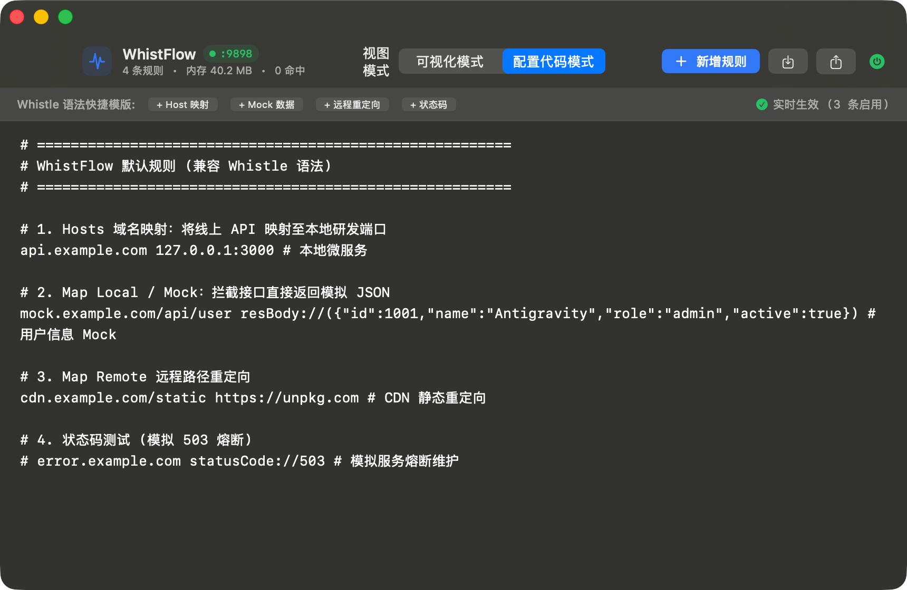

# WhistFlow 🌊
> **Swift 原生极简 macOS 调试代理软件**
> 基于 Whistle 精炼重构，专为 macOS 打造。极致轻量、亚秒级启动、Liquid Glass 玻璃材质、双模式操作。


---

## 📸 界面预览

### 1. 可视化模式 (Visual Mode)
以优雅的 macOS 原生 Liquid Glass 流体卡片直观呈现代理规则，具备实时开关、类型徽章、分类过滤与快捷操作：


### 2. 文本配置模式 (Configuration Mode)
兼容标准 Whistle 规则语法的纯文本编辑器，支持单色字体、快捷语法模板插入与实时生效状态校验：



### 3. 原生规则编辑弹窗
点击「新增规则」或按快捷键 `⌘N` 唤出原生 macOS 毛玻璃表单弹窗：


---

## ✨ 核心特性

1. **专注纯粹代理**：
   - 彻底剥离笨重的抓包分析面板与冗余插件，聚焦核心代理与规则路由能力。
   - 支持 **Hosts 域名映射**、**Map Remote 远程重定向**、**Map Local / Mock 数据**、**请求/响应头注入** 以及 **状态码重写**。
2. **macOS 26/27 原生质感**：
   - 采用 Apple Human Interface Guidelines 规范与 Liquid Glass 流体毛玻璃材质。
   - 连续平滑超椭圆圆角（Continuous Squircle）、语义化色阶、沉静克制的单重点色设计。
   - 预留完整的窗口红绿灯安全交互区（78pt 避让）。
3. **双模式无缝切换**：
   - **可视化模式 (Visual Mode)**：卡片交互直观呈现，支持一键实时开关、类型徽章、分类过滤（`⌘1`）。
   - **文本配置模式 (Config Mode)**：与经典 Whistle 语法完全兼容的高效纯文本编辑器（`⌘2`）。
   - 两种模式之间双向原子级实时同步。
4. **开关实时生效 (Zero-Restart)**：
   - 任何规则的开关切换或文本变动均在底层原子级生效，无需重启代理服务。
5. **极速与低内存 (Ultra-Lightweight)**：
   - 基于原生 Swift 与 Apple `Network.framework` 异步网络模型构建。
   - **冷启动就绪速度仅需 2.9 ms**，**基础常驻内存仅约 9.4 MB**（相比传统 Electron/Node.js 工具降低 90% 以上）。
6. **配置导入与导出**：
   - 支持标准 Whistle 规则格式（`.txt`）与结构化配置（`.json`）的无缝导入导出（`⌘O` / `⌘S`）。
7. **环境安全隔离**：
   - 独立端口运行（默认 `9898`），不强制劫持全局系统网络设置，绝不干扰现有的 Clash / VPN 代理环境。

---

## ⚡ 性能基准对比

| 指标 | **WhistFlow (本项目)** | **Proxyman** | **Charles** | **Whistle (Node.js)** |
| :--- | :--- | :--- | :--- | :--- |
| **技术栈** | **Swift 6 + Network.framework** | Swift + SwiftNIO | Java (需 JVM) | Node.js + WebUI |
| **安装包体积** | **1.1 MB** | ~60 MB | ~100 MB | ~50 MB (需装 Node) |
| **冷启动时间** | **2.9 ms** | ~0.8 s | ~5.0 s | 需打开浏览器 |
| **空闲内存占用** | **~9.4 MB** | ~60 MB | ~450 MB | ~80 MB + 浏览器标签 |
| **UI 材质与架构** | **macOS 原生 Liquid Glass** | macOS 原生 | Java Swing | 网页 Web 界面 |

---

## 📖 Whistle 语法支持矩阵

WhistFlow 原生兼容经典 Whistle 规则语法：

| 规则类型 | Whistle 语法示例 | 说明 |
| :--- | :--- | :--- |
| **Hosts 域名映射** | `dev.example.com 127.0.0.1:3000` | 将特定域名路由至本地开发端口 |
| **Map Remote** | `api.prod.com/v1 https://api.dev.com/v1` | 远程请求路径重定向 |
| **Map Local / Mock** | `api.test.com/user resBody://({"name":"Alice","role":"admin"})` | 本地或内联 Mock JSON 数据响应 |
| **Header 注入** | `*.example.com reqHeaders://{"Authorization":"Bearer debug"}` | 注入自定义请求头 |
| **状态码重写** | `error.test.com statusCode://503` | 模拟特定 HTTP 异常状态码 |
| **规则禁用/启用** | `# dev.example.com 127.0.0.1:3000` | 行首添加 `#` 注释即关闭规则 |

---

## ⌨️ 快捷键指南

| 快捷键 | 功能描述 |
| :--- | :--- |
| **`⌘1`** | 切换至「可视化展示模式」 |
| **`⌘2`** | 切换至「Whistle 文本配置模式」 |
| **`⌘N`** | 唤出新建规则弹窗 |
| **`⌘O`** | 导入 Whistle 规则文件 |
| **`⌘S`** | 导出当前规则文件 |
| **`⌘Q`** | 退出 WhistFlow |

---

## 🛠️ 构建与运行

### 环境要求
* macOS 14.0+ (全面适配 macOS 26/27)
* Swift 6.0+

### 快速编译与打包
```bash
# 克隆工程
git clone https://github.com/guodonglu/WhistFlow.git
cd WhistFlow

# 编译 Release
swift build -c release

# 运行应用程序
open WhistFlow.app
```

---

## 📄 开源许可
MIT License © 2026 WhistFlow Team
