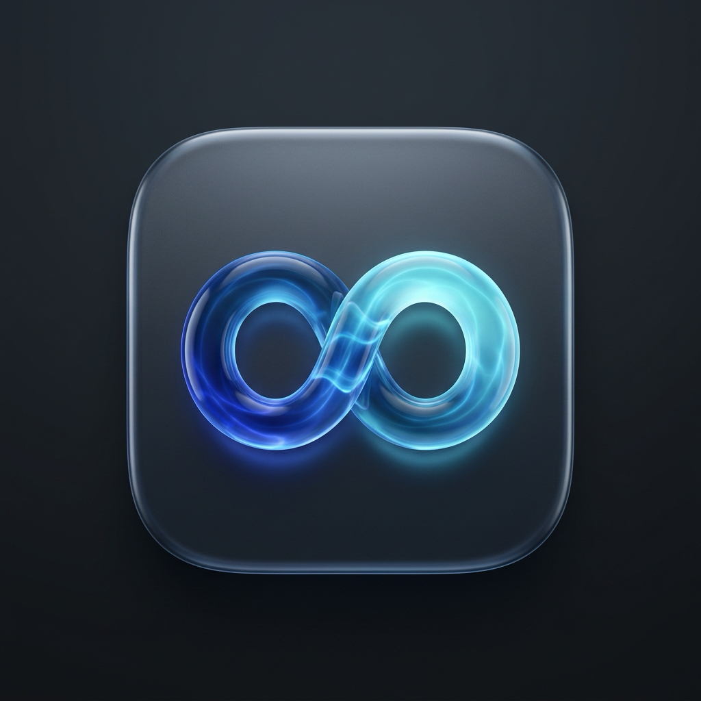
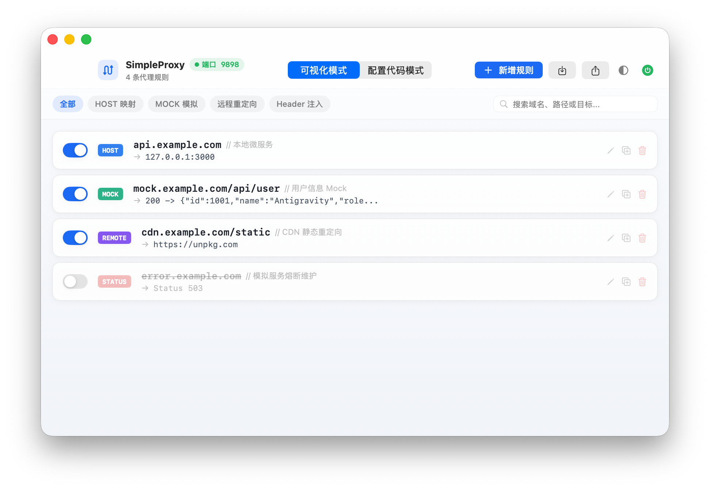
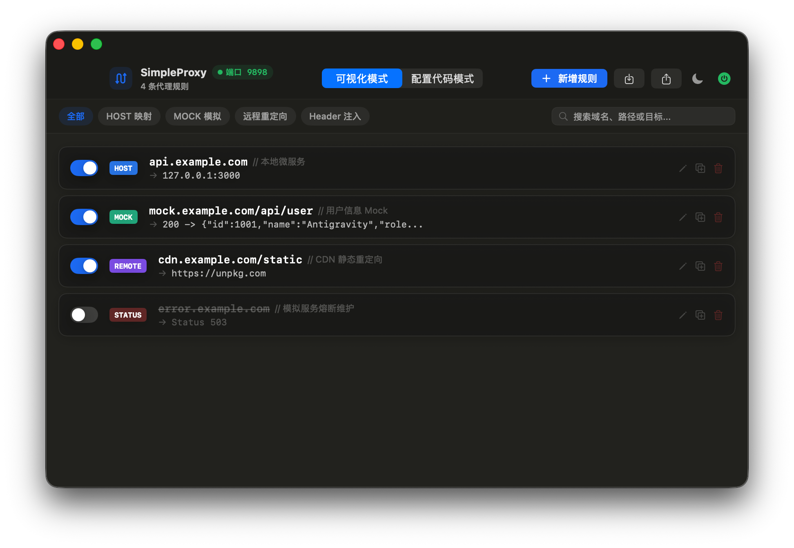
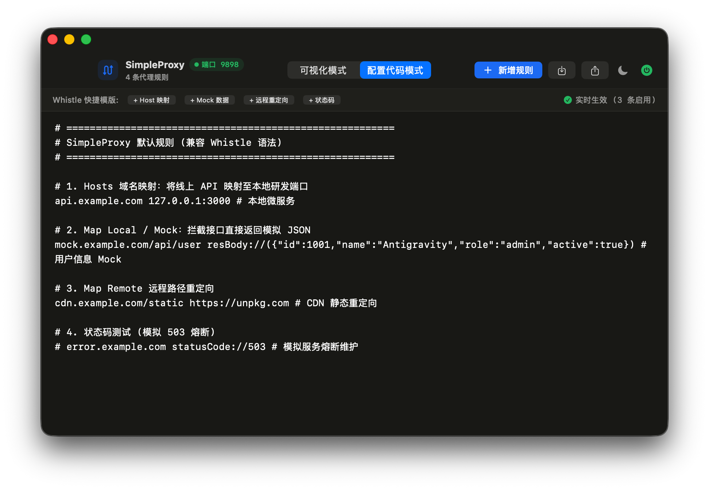
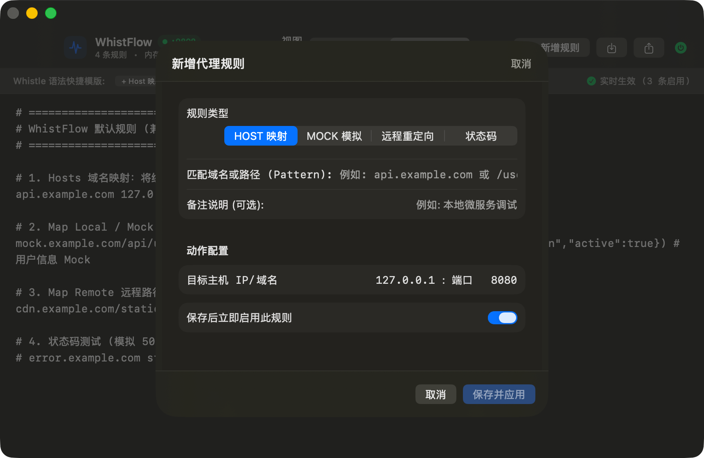

# SimpleProxy ⚡

<p align="center">
  
  <br>
  <strong>iOS 27 & macOS Liquid Glass 极简原生代理工具</strong>
  <br>
  <em>极致轻量 · 极速启动 · 独立隔离 · 兼容 Whistle 语法</em>
</p>

<p align="center">
  
  
  
  
  
  
  
</p>

---

## 📸 界面预览

### 1. 浅色模式原生适配 (Light Mode)
精细打磨的 iOS 27 / macOS 26+ 晶莹 Liquid Glass 流体毛玻璃质感与 SF 字体，去除繁杂，专注极简代理体验：



### 2. 深色模式原生适配 (Dark Mode)
深邃夜色下的微光折射与高对比度语义化标签，沉静克制：



### 3. 文本配置代码模式 (Configuration Mode)
兼容标准 Whistle 规则语法的纯文本编辑器，支持单色字体、快捷语法模板插入与实时生效状态校验：



### 4. 原生规则编辑弹窗
点击「新增规则」或按快捷键 `⌘N` 唤出原生 macOS 毛玻璃表单弹窗：



---

## ✨ 核心特性

1. **专注纯粹代理**：
   - 彻底剥离笨重的抓包分析面板与冗余插件，聚焦核心代理与规则路由能力。
   - 支持 **Hosts 域名映射**、**Map Remote 远程重定向**、**Map Local / Mock 数据**、**请求/响应头注入** 以及 **状态码重写**。
2. **iOS 27 / macOS Liquid Glass 设计规范**：
   - 采用 Apple Human Interface Guidelines 规范与 Liquid Glass 流体毛玻璃材质。
   - 连续平滑超椭圆圆角（Continuous Squircle）、极简光感流动图标、语义化色阶、沉静克制的单重点色设计。
   - 顶部居中极简模式分段切换器（去除了多余文字标签），清爽利落。
3. **双模式无缝切换**：
   - **可视化模式 (Visual Mode)**：卡片交互直观呈现，支持一键实时开关、类型徽章、分类过滤（`⌘1`）。
   - **配置代码模式 (Config Mode)**：与经典 Whistle 语法完全兼容的高效纯文本编辑器（`⌘2`）。
   - 两种模式之间双向原子级实时同步。
4. **开关实时生效 (Zero-Restart)**：
   - 任何规则的开关切换或文本变动均在底层原子级生效，无需重启代理服务。
5. **极速与低内存 (Ultra-Lightweight)**：
   - 基于原生 Swift 与 Apple `Network.framework` 异步网络模型构建。
   - **冷启动就绪速度仅需 2.9 ms**，**基础常驻内存仅约 9.4 MB**（相比传统 Electron/Node.js 工具降低 90% 以上）。
6. **配置导入与导出**：
   - 支持标准 Whistle 规则格式（`.txt`）与结构化配置（`.json`）的无缝导入导出（`⌘O` / `⌘S`）。
7. **环境安全隔离**：
   - 独立端口运行（默认 `9898`），不强制劫持全局系统网络设置，绝不干扰现有的 Clash / VPN 代理环境。

---

## ⚡ 性能基准对比

| 指标 | **SimpleProxy (本项目)** | **Proxyman** | **Charles** | **Whistle (Node.js)** |
| :--- | :--- | :--- | :--- | :--- |
| **技术栈** | **Swift 6 + Network.framework** | Swift + SwiftNIO | Java (需 JVM) | Node.js + WebUI |
| **安装包体积** | **3.1 MB** (二进制仅 1.2MB) | ~60 MB | ~100 MB | ~50 MB (需装 Node) |
| **冷启动时间** | **2.9 ms** | ~0.8 s | ~5.0 s | 需打开浏览器 |
| **空闲内存占用** | **~9.4 MB** | ~60 MB | ~450 MB | ~80 MB + 浏览器标签 |
| **系统侵入性** | **零侵入** (独立端口) | 需装 Root 证书与助手 | 需装 Root 证书 | 需装根证书与全局代理 |
| **多核并发能力** | 原生 GCD / async-await | NIO EventLoop | 多线程 | 单线程 EventLoop |

---

## 🚀 快速开始

### 方式 1：直接运行预编译 App
克隆代码库后直接打开 `SimpleProxy.app`：
```bash
open SimpleProxy.app
```

### 方式 2：从源码编译
```bash
git clone https://github.com/guodonglu/WhistFlow.git
cd WhistFlow
swift build -c release
./.build/release/SimpleProxy
```

---

## 🛠️ CLI 命令行与 MCP 支持

SimpleProxy 内置轻量级本地管理 REST API (`127.0.0.1:9898/_simpleproxy/api`)，并提供配套 CLI 与 Agent Skill。

### CLI 工具使用
```bash
# 查看代理运行状态
simpleproxy status

# 查看当前已配置的所有规则
simpleproxy rules

# 添加 Host 映射
simpleproxy add "api.internal.com" "127.0.0.1:3000" --type host -c "本地开发重定向"

# 添加 Mock 数据
simpleproxy add "cdn.example.com/api" '{"code":200,"msg":"mocked"}' --type resBody

# 切换规则开关
simpleproxy toggle 1 --disable

# 删除规则
simpleproxy delete 1

# 切换外观 (浅色 / 深色 / 系统)
simpleproxy theme light
simpleproxy theme dark

# 切换窗口模式 (可视化 / 配置模式)
simpleproxy mode visual
simpleproxy mode config
```

---

## 📄 规则语法速查 (兼容 Whistle)

| 规则类型 | 语法示例 | 说明 |
| :--- | :--- | :--- |
| **Host 映射** | `api.dev.com 127.0.0.1:3000` | 将域名请求转发至本地或内网 IP |
| **远程重定向** | `cdn.example.com https://cdn.bootcdn.net` | 替换远程基地址与路径 |
| **Mock 数据** | `api.dev.com/user resBody://{"name":"test"}` | 模拟接口返回自定义 JSON |
| **状态码重写** | `bad.example.com statusCode://503` | 模拟服务端 503/404 等故障 |
| **响应头注入** | `test.com resHeaders://{"X-Env":"dev"}` | 动态注入自定义 Header |

---

## 📄 开源许可证

本项目基于 [MIT 许可证](LICENSE) 开源。
